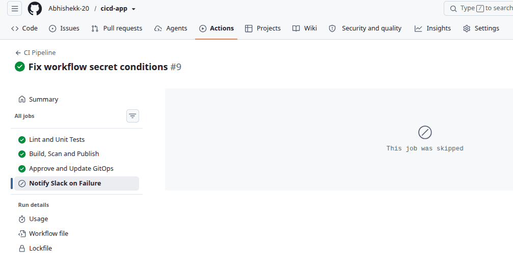
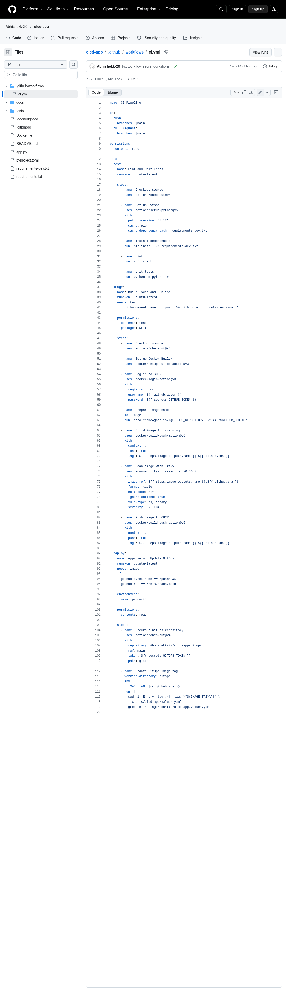
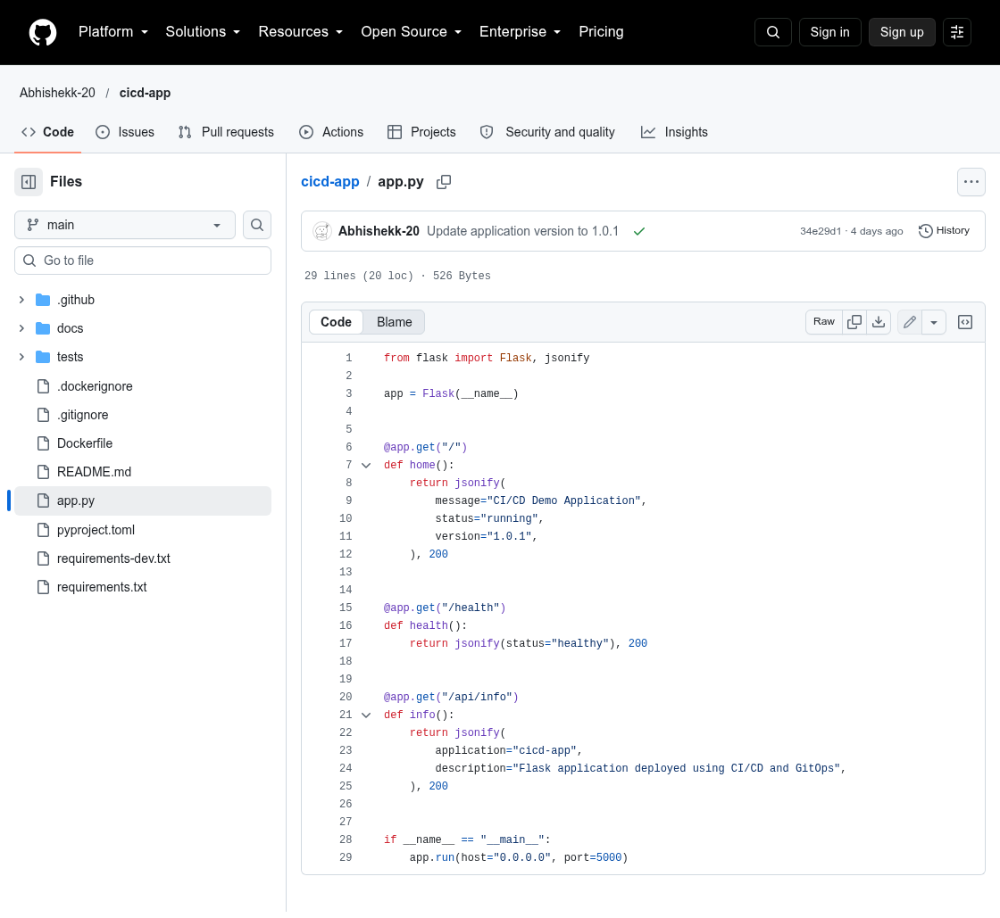
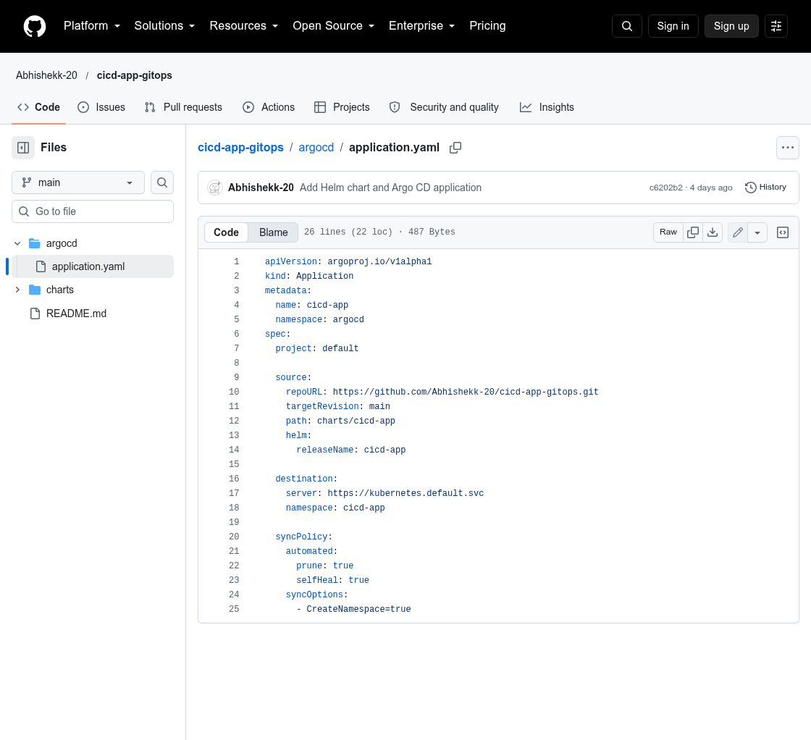
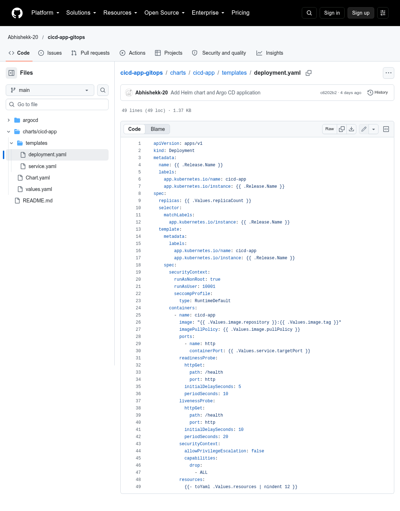
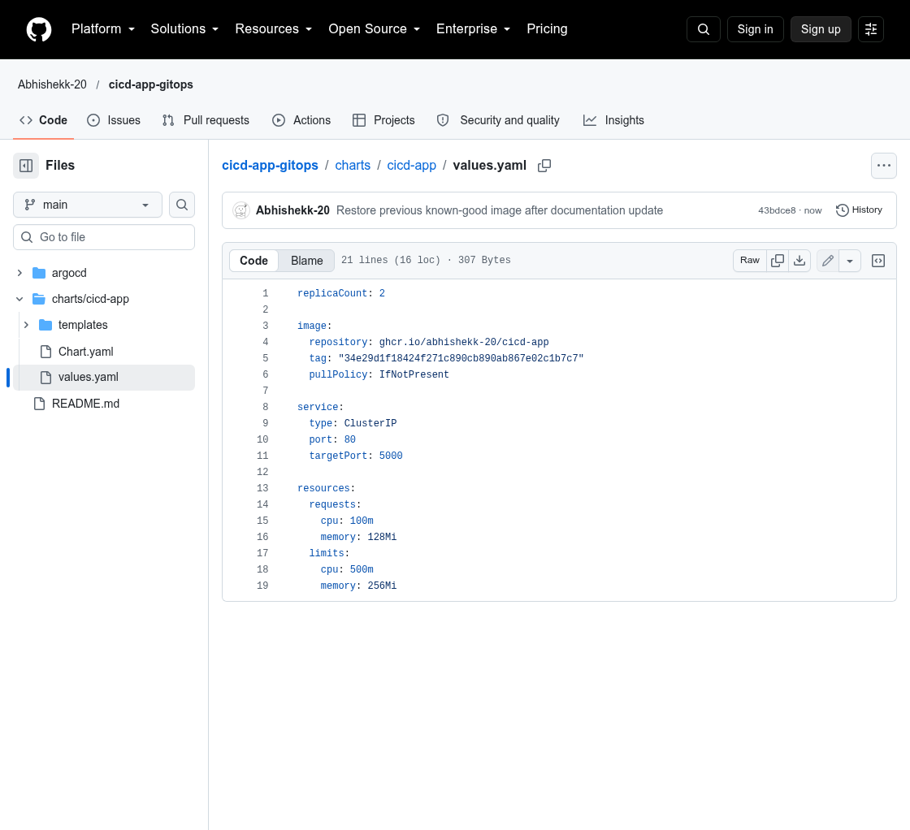

# CI/CD Demo Application

A small Flask application demonstrating a CI/CD pipeline with container security scanning, a production approval gate, and GitOps-based Kubernetes deployment.

## Architecture

```text
Push to main / Pull request
          |
          v
  Ruff lint + pytest
          |
          | main branch only
          v
 Build Docker image -> Trivy scan for CRITICAL vulnerabilities -> Push to GHCR
          |
          v
 GitHub Environment: production (required reviewer approval)
          |
          v
 Update image tag in cicd-app-gitops repository
          |
          v
 Argo CD syncs the Helm chart to Kubernetes
          |
          v
  Running application

Main-branch pipeline failures -> Slack Incoming Webhook notification
```

Pull requests run lint and unit tests. Image publishing and the GitOps update run only after a push to `main`.

## Repositories

- Application and workflow: https://github.com/Abhishekk-20/cicd-app
- Helm chart and Argo CD configuration: https://github.com/Abhishekk-20/cicd-app-gitops

## Technology stack

- Python, Flask, Gunicorn
- Ruff and pytest
- Docker and Docker Buildx
- GitHub Actions
- Trivy image vulnerability scanning
- GitHub Container Registry (GHCR)
- Kubernetes, Helm, and Argo CD
- Slack Incoming Webhooks for failure alerts

## Application endpoints

| Endpoint | Purpose |
| --- | --- |
| `GET /` | Returns application status and version |
| `GET /health` | Health check |
| `GET /api/info` | Application metadata |

## Run checks locally

Use Python 3.12 or a compatible environment:

```bash
python3 -m venv .venv
source .venv/bin/activate
pip install -r requirements-dev.txt
ruff check .
python -m pytest -v
```

Build the container image:

```bash
docker build -t cicd-app:local .
```

Inspect the Dockerfile for the configured port and runtime command before running the container locally.

## GitHub configuration

Configure these in the application repository's **Settings → Secrets and variables → Actions**:

| Secret | Purpose |
| --- | --- |
| `GITOPS_TOKEN` | Token with the required contents write access to `cicd-app-gitops` |
| `SLACK_WEBHOOK_URL` | Slack Incoming Webhook URL for failure alerts |

The workflow uses the automatically provided `GITHUB_TOKEN` to publish images to GHCR. Make sure the workflow has package write permission and the image is pullable by the cluster (public package or an appropriately configured image pull secret).

Create a GitHub Environment named `production` and configure required reviewers under **Settings → Environments**. The `deploy` job must pass this environment gate before it can update the GitOps repository.

Never put tokens, webhook URLs, account identifiers, or other secrets in source control or this README.

## Deployment checks

These commands assume the cluster context points to the intended Kubernetes cluster:

```bash
kubectl get application cicd-app -n argocd
kubectl get deployment,pods,svc -n cicd-app
kubectl rollout status deployment/cicd-app -n cicd-app
kubectl get deployment cicd-app -n cicd-app \
  -o=jsonpath='{.spec.template.spec.containers[0].image}{"\\n"}'
```

Check the Argo CD Application for `Synced` and `Healthy`, and compare the configured deployment image tag with `charts/cicd-app/values.yaml` in the GitOps repository.

To test the app locally through a cluster service, run this in one terminal:

```bash
kubectl port-forward -n cicd-app svc/cicd-app 8080:80
```

Then, in another terminal:

```bash
curl -i http://localhost:8080/health
curl -i http://localhost:8080/api/info
curl -i http://localhost:8080/
```

If port-forwarding stops, restart it before using `curl`.

## Manual rollback

This project demonstrates a **manual GitOps rollback** by reverting the commit that introduced a bad image tag. First confirm the exact deployment commit and that the working tree is clean. Do not blindly revert the latest commit if it is already a rollback or contains unrelated changes.

```bash
cd ~/cicd-app-gitops
git status --short
git log -5 --oneline -- charts/cicd-app/values.yaml
```

Choose the commit that deployed the undesired image tag, then revert that commit and push:

```bash
git revert <bad-deployment-commit>
git push origin main
```

Argo CD should reconcile the restored image tag. Verify the result:

```bash
kubectl rollout status deployment/cicd-app -n cicd-app
kubectl get deployment cicd-app -n cicd-app \
  -o=jsonpath='{.spec.template.spec.containers[0].image}{"\\n"}'
kubectl get application cicd-app -n argocd \
  -o=jsonpath='Sync={.status.sync.status} Health={.status.health.status}{"\\n"}'
```

A successful rollback should show the expected previous image tag, a completed rollout, and Argo CD reporting `Synced` and `Healthy`. This is a GitOps-based manual rollback, not an automated rollback controller.

## Failure notifications

For pushes to `main`, the workflow attempts to notify Slack when the test, image build/scan/publish, or GitOps update job fails. If the webhook secret is missing, the notification step skips sending. Check the GitHub Actions run logs first; never print or share the webhook URL.

## Project Screenshots

The following images document the actual public repository and the CI/CD run. The pipeline overview image was supplied from the real Actions run; the code/configuration images are captures of files in these repositories.

### 1. Successful GitHub Actions run

This run shows the lint/test, build-scan-publish, and GitOps-update jobs succeeding. The Slack notification job is skipped when the pipeline succeeds.



[Open the recorded Actions run](https://github.com/Abhishekk-20/cicd-app/actions/runs/40199703067)

### 2. CI/CD workflow definition



### 3. Flask application source



### 4. Argo CD Application manifest

This is the real GitOps manifest that points Argo CD to the Helm chart in this repository.



### 5. Kubernetes Deployment Helm template



### 6. GitOps image tag and rollback target

The screenshot shows the GitOps values file after restoring the previously working image tag.



> These screenshots cover repository and GitHub Actions evidence. The Kubernetes pod output, live Argo CD dashboard, and `curl` responses come from the local cluster, so capture those directly on the machine running KIND if you want to show those specific live screens too.
