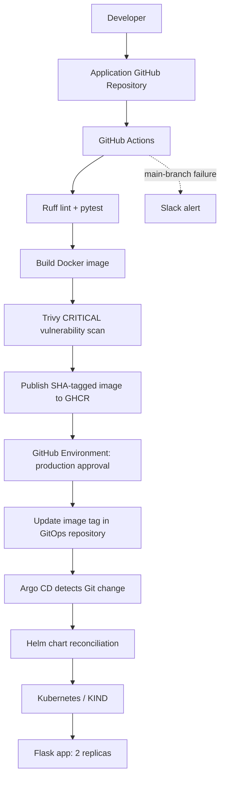
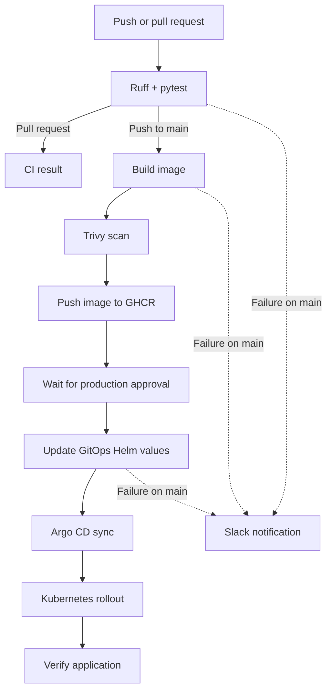

# DevOps Project Report: Automated CI/CD Pipeline with GitHub Actions, Docker, Trivy, GHCR, Kubernetes and Argo CD

A step-by-step report for a Flask application delivered through CI checks, container security scanning, GitHub Container Registry (GHCR), a production approval gate, and GitOps deployment with Helm and Argo CD.

> **Project scope:** This implementation deploys the Flask demo application to the `cicd-app` namespace in a Kubernetes cluster managed by KIND. It demonstrates a cloud-native delivery workflow; the current deployment target documented here is Kubernetes/KIND, not an AWS-managed EKS cluster.

---

## Table of Contents

1. [Project Overview](#1-project-overview)
2. [Architecture Diagram](#2-architecture-diagram)
3. [Repository Structure](#3-repository-structure)
4. [Step 1: Flask Application and Unit Tests](#4-step-1-flask-application-and-unit-tests)
5. [Step 2: Docker Containerization](#5-step-2-docker-containerization)
6. [Step 3: GitHub Actions CI Pipeline](#6-step-3-github-actions-ci-pipeline)
7. [Step 4: Trivy Security Scan and GHCR Publishing](#7-step-4-trivy-security-scan-and-ghcr-publishing)
8. [Step 5: Production Approval Gate](#8-step-5-production-approval-gate)
9. [Step 6: GitOps with Helm and Argo CD](#9-step-6-gitops-with-helm-and-argo-cd)
10. [Step 7: Verify the Kubernetes Deployment](#10-step-7-verify-the-kubernetes-deployment)
11. [Step 8: Slack Failure Notifications](#11-step-8-slack-failure-notifications)
12. [Step 9: Manual GitOps Rollback](#12-step-9-manual-gitops-rollback)
13. [Workflow Diagram](#13-workflow-diagram)
14. [Conclusion](#14-conclusion)

---

## 1. Project Overview

The project demonstrates an automated delivery process for a small Flask application. Source changes are checked in GitHub Actions, container images are built and scanned, approved images are published to GHCR, and the GitOps repository is updated only after the production environment approval gate.

The separate GitOps repository stores the desired Kubernetes state in a Helm chart. Argo CD watches that repository and reconciles the Helm release into Kubernetes.

### Key features

- **Continuous Integration:** Ruff linting and pytest unit tests.
- **Containerization:** Docker image built with Docker Buildx.
- **Security scanning:** Trivy blocks publishing when the configured scan finds vulnerabilities that meet the **CRITICAL** severity rule.
- **Image registry:** Commit-SHA image tags in GHCR.
- **Deployment approval:** GitHub Environment named `production`.
- **GitOps delivery:** GitHub Actions updates the Helm values file; Argo CD syncs the desired state.
- **Failure notification:** Slack Incoming Webhook alerts for main-branch job failures.
- **Rollback:** A previous image tag can be restored by reverting the GitOps deployment commit.

### Repositories

- **Application and workflow:** [Abhishekk-20/cicd-app](https://github.com/Abhishekk-20/cicd-app)
- **Helm chart and Argo CD application:** [Abhishekk-20/cicd-app-gitops](https://github.com/Abhishekk-20/cicd-app-gitops)

---

## 2. Architecture Diagram

The production path below applies to pushes to `main`. Pull requests run lint and unit tests; image publication and GitOps updating are limited to main-branch pushes.



---

## 3. Repository Structure

### Application repository

```text
cicd-app/
├── .github/
│   └── workflows/
│       └── ci.yml
├── tests/
│   └── test_app.py
├── docs/
│   └── images/
├── app.py
├── Dockerfile
├── requirements.txt
├── requirements-dev.txt
├── pyproject.toml
└── README.md
```

### GitOps repository

```text
cicd-app-gitops/
├── argocd/
│   └── application.yaml
└── charts/
    └── cicd-app/
        ├── Chart.yaml
        ├── values.yaml
        └── templates/
            ├── deployment.yaml
            └── service.yaml
```

---

## 4. Step 1: Flask Application and Unit Tests

The Flask application exposes three endpoints:

| Endpoint | Purpose |
| --- | --- |
| `GET /` | Application status and version |
| `GET /health` | Health check |
| `GET /api/info` | Application metadata |

The project includes pytest tests and uses Ruff to check code style before a container image is built.

**Application source — `app.py`**

**Application source:** [`app.py`](app.py)

**Unit tests — `tests/test_app.py`**

**Unit tests:** [`tests/test_app.py`](tests/test_app.py)

To run the checks locally from the application directory:

```bash
python3 -m venv .venv
source .venv/bin/activate
pip install -r requirements-dev.txt
ruff check .
python -m pytest -v
```

---

## 5. Step 2: Docker Containerization

The Dockerfile packages the Flask app for consistent execution in CI and Kubernetes. The workflow uses Docker Buildx to build an image tagged with the commit SHA.

**Dockerfile in the application repository**

**Dockerfile:** [`Dockerfile`](Dockerfile)

Build a local image for a quick check:

```bash
docker build -t cicd-app:local .
```

The pipeline image name follows this format:

```text
ghcr.io/abhishekk-20/cicd-app:<git-commit-sha>
```

Commit-SHA tags make it possible to identify the exact application revision being deployed and to select a previous known-good image for rollback.

---

## 6. Step 3: GitHub Actions CI Pipeline

The workflow is defined in `.github/workflows/ci.yml`.

The **Lint and Unit Tests** job checks out the source, sets up Python 3.12, installs development dependencies, runs `ruff check .`, and runs `python -m pytest -v`.

The workflow has path filters so changes limited to `README.md` or `docs/**` do not trigger a new deployment pipeline.

**Workflow configuration**

**Workflow definition:** [`.github/workflows/ci.yml`](.github/workflows/ci.yml)

**Successful Actions run**


[View the recorded successful GitHub Actions run](https://github.com/Abhishekk-20/cicd-app/actions/runs/40207172479)

---

## 7. Step 4: Trivy Security Scan and GHCR Publishing

After lint and tests pass on a push to `main`, the image job:

1. Sets up Docker Buildx and logs in to GHCR using the workflow-provided `GITHUB_TOKEN`.
2. Builds the image using the current commit SHA as its tag.
3. Scans the built image using Trivy.
4. Pushes the image to GHCR only if the scan succeeds.

The scan is configured with `severity: CRITICAL`, `exit-code: "1"`, and `ignore-unfixed: true`. Vulnerabilities matching the configured rules can stop the pipeline before the push step.

The image job grants `packages: write`; the workflow does not store the registry token in the repository. Ensure the GHCR package is pullable by the Kubernetes cluster (for example, make the package public or configure an image pull secret if it is private).

---

## 8. Step 5: Production Approval Gate

The `deploy` job references the GitHub Environment `production`. GitHub pauses this job for the required reviewer approval configured on that environment. After approval, the job checks out the GitOps repository using `GITOPS_TOKEN`, updates the Helm image tag, and pushes a GitOps commit.

Configure these under the application repository's **Settings → Environments** and **Settings → Secrets and variables → Actions**:

| Configuration | Purpose |
| --- | --- |
| Environment: `production` | Approval gate before GitOps changes |
| `GITOPS_TOKEN` secret | Write access to the `cicd-app-gitops` repository |
| `SLACK_WEBHOOK_URL` secret | Slack Incoming Webhook for failure alerts |

The secret values must be added in GitHub Settings; never copy their values into source control or this README.

---

## 9. Step 6: GitOps with Helm and Argo CD

The `cicd-app-gitops` repository is the source of desired deployment state. The application workflow changes the `image.tag` in `charts/cicd-app/values.yaml` to the new Git commit SHA. Argo CD watches the GitOps repository and automatically reconciles the Helm chart.

### Argo CD Application

The manifest at `argocd/application.yaml` points Argo CD at the `charts/cicd-app` path in the GitOps repository. Automated sync, pruning, and self-healing are configured in the manifest.

**Argo CD Application manifest:** [`argocd/application.yaml`](https://github.com/Abhishekk-20/cicd-app-gitops/blob/main/argocd/application.yaml)

### Helm Deployment and Service

The Helm chart defines a two-replica Flask deployment, health probes, container security settings, and a ClusterIP service mapping service port 80 to the application container port 5000.

**Deployment template**

**Helm Deployment template:** [`deployment.yaml`](https://github.com/Abhishekk-20/cicd-app-gitops/blob/main/charts/cicd-app/templates/deployment.yaml)

**Service template**

**Helm Service template:** [`service.yaml`](https://github.com/Abhishekk-20/cicd-app-gitops/blob/main/charts/cicd-app/templates/service.yaml)

**Image tag in the GitOps values file**

**Helm values / image tag:** [`values.yaml`](https://github.com/Abhishekk-20/cicd-app-gitops/blob/main/charts/cicd-app/values.yaml)

The GitOps repository is available at [cicd-app-gitops](https://github.com/Abhishekk-20/cicd-app-gitops).

---

## 10. Step 7: Verify the Kubernetes Deployment

The deployment was verified in the `cicd-app` namespace with two running application replicas, a successful rollout, a healthy Argo CD Application, and successful HTTP responses from the Flask endpoints.

Run these commands against your cluster context:

```bash
kubectl get pods -n cicd-app
kubectl rollout status deployment/cicd-app -n cicd-app
kubectl get application cicd-app -n argocd
kubectl get deployment cicd-app -n cicd-app \
  -o=jsonpath='{.spec.template.spec.containers[0].image}{"\\n"}'
```

Expected checks:
- Both `cicd-app` pods are `Running` and `1/1 Ready`.
- The deployment rollout completes successfully.
- The Argo CD Application reports `Synced` and `Healthy`.
- The live Deployment image matches the image tag in `charts/cicd-app/values.yaml`.

To test the service locally, start port-forwarding in one terminal:

```bash
kubectl port-forward -n cicd-app svc/cicd-app 8080:80
```

Then, from another terminal:

```bash
curl -i http://localhost:8080/health
curl -i http://localhost:8080/api/info
curl -i http://localhost:8080/
```

Observed responses included `HTTP/1.1 200 OK`, `{"status":"healthy"}`, and the root endpoint reporting application version `1.0.1`. If port-forwarding is stopped, restart it before calling `curl`.

---

## 11. Step 8: Slack Failure Notifications

The `notify-failure` job uses the `SLACK_WEBHOOK_URL` repository secret to post an alert for main-branch pushes when any of these jobs fails:

- Lint and Unit Tests
- Build, Scan and Publish
- Approve and Update GitOps

The message contains the repository, branch, commit SHA, and link to the Actions run. The notification job is skipped for a successful run. If the webhook secret is empty, the step exits without sending a message. Do not deliberately break the production pipeline just to test alerts; use a separate test branch or a safe test workflow if you want to validate the webhook.

---

## 12. Step 9: Manual GitOps Rollback

This project has demonstrated a GitOps rollback. The latest deployment commit was reverted, the GitOps image tag was restored to the previously working image, and Argo CD reported `Synced` and `Healthy` while the live Kubernetes Deployment used that previous SHA-tagged image.

A rollback changes the desired image tag in Git; it does not roll back Git history destructively and it is not an automatic rollback controller.

### Inspect recent deployment commits

```bash
cd ~/cicd-app-gitops
git status --short
git log -5 --oneline -- charts/cicd-app/values.yaml
grep -n '^  tag:' charts/cicd-app/values.yaml
```

Ensure the working tree is clean. Identify the commit that introduced the bad image tag. Do not blindly revert the newest commit if it is already a rollback or contains unrelated changes.

### Revert the offending deployment commit

Replace `<bad-deployment-commit>` with the identified commit SHA:

```bash
git revert <bad-deployment-commit>
git push origin main
```

Argo CD should detect the new Git commit and reconcile the restored Helm values. If it does not sync, inspect the Argo CD Application status and trigger a sync using your configured Argo CD CLI or UI.

### Verify the rollback

```bash
kubectl rollout status deployment/cicd-app -n cicd-app

kubectl get deployment cicd-app -n cicd-app \
  -o=jsonpath='{.spec.template.spec.containers[0].image}{"\\n"}'

kubectl get application cicd-app -n argocd \
  -o=jsonpath='Sync={.status.sync.status} Health={.status.health.status}{"\\n"}'
```

The verified rollback image tag for this run was:

```text
ghcr.io/abhishekk-20/cicd-app:34e29d1f18424f271c890cb890ab867e02c1b7c7
```

The application continued to return HTTP 200 after the rollback; both the GitOps desired tag and live Kubernetes image were checked.

---

## 13. Workflow Diagram



---

## 14. Conclusion

This project demonstrates an end-to-end cloud-native delivery workflow using GitHub Actions, Docker, Trivy, GHCR, GitHub Environment protection, Helm, Argo CD, and Kubernetes. It includes tested application endpoints, commit-SHA image tagging, an approval gate before GitOps promotion, Slack failure notifications, and a manual GitOps rollback procedure.

The implementation is suitable as a hands-on DevOps portfolio project. It should be described as a personal project, not as production work experience.
